# Hi, I'm Ly Manny 👋

**Software & iOS Engineer · GKS-G 2025 Scholar · Master's Student in AI in Healthcare**

## 👨‍💻 About Me

I'm a **Software & iOS Engineer with 4+ years of experience at KOSIGN (Cambodia) Investment Co., Ltd.**, including **one year at Webcash Busan IT Center**. My professional background includes mobile applications for financial services, payments, and enterprise workflows.

I'm now a **GKS-G 2025 Scholar** pursuing a **Master's degree in AI in Healthcare at Inje University, South Korea**. I'm exploring machine learning, computer vision, and medical image analysis, especially potential applications in skin lesion research.

## 🛠️ Technologies & Tools

**Mobile Development**

`UIKit` · `SwiftUI` · `Jetpack Compose` · `Vapor`

**Backend, Web & Design**

**AI & Computer Vision — Learning and Building**

`NumPy` · `Matplotlib` · `Machine Learning` · `Image Processing`

**Developer Tools**

## 💼 Professional iOS Experience

**KOSIGN (Cambodia) Investment Co., Ltd.** — Software & iOS Engineering (4+ years, including 1 year at Webcash Busan IT Center)

I have developed, maintained, and contributed to the following **team/company applications**. These are professional contributions, not projects I claim to own individually.

| Finance & Payments | Business Applications | Regional & Other Applications |
| :-- | :-- | :-- |
| 비플페이 | 비즈플레이 | 경남지역상품권 |
| IBK 법인카드 | 비즈플레이 On-Premise | 창원 누비전 |
| 체크페이 | WABOOKS | 춘천사랑상품권 |
| 비플 법인카드 | WeBill365 | 강원상품권 |
| 비플 개인카드 | H-eat + | BNKC Lao |

For app visuals and additional information, visit my [portfolio](https://lymanny.onrender.com).

 

<a href="https://medicalskin-ai.onrender.com/">
<picture>
  <source media="(prefers-color-scheme: light)" srcset="./assets/medscan-light.svg" />
  
</picture>
</a>

---

**Software & iOS Engineering | Medical IT | AI in Healthcare 🩺**

[Portfolio](https://lymanny.onrender.com) · [LinkedIn](https://www.linkedin.com/in/lymanny/) · [Repositories](https://github.com/lymanny?tab=repositories)

